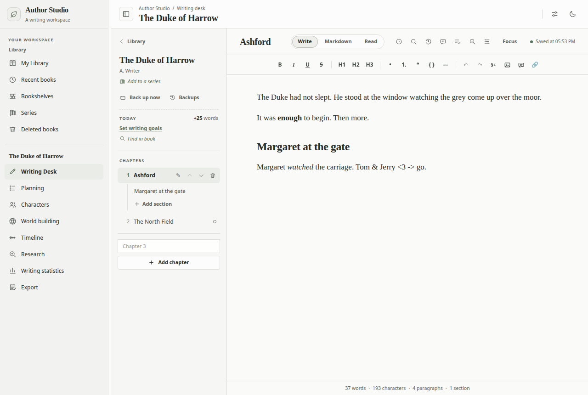
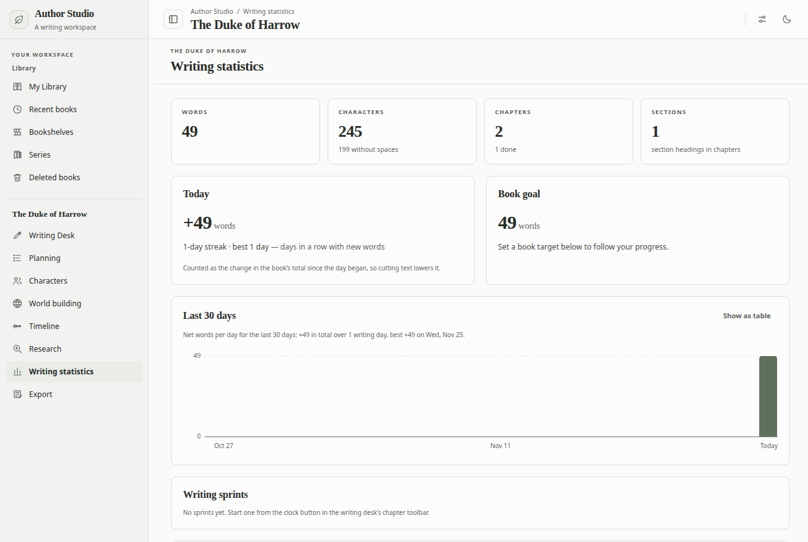

# Author Studio

A calm, local-first desktop writing studio for book authors.

Your books are ordinary folders on your own computer. Nothing is sent anywhere, and the app does not use the network.



## What it does

- **Write** in a clean editor, in Markdown, or in a read-through view, with chapters and sections.
- **Plan** with an outline and a chapter board.
- **Keep track** of characters, relationships, world building, a timeline and research notes.
- **Protect your text** with saved versions, recovery drafts and verified backups.
- **See your progress** with word counts, daily totals, goals and writing sprints.
- **Organise** books into bookshelves and series.
- **Export** to Word and EPUB, or to PDF through the system print dialog.



## Download (Linux, 64-bit)

**[Go to the downloads page](https://github.com/ArunSelvan25/author-studio/releases)**

| Your system | File to download |
|---|---|
| Ubuntu, Debian, Linux Mint | `author-studio_<version>_amd64.deb` |
| Fedora, openSUSE | `author-studio-<version>-1.x86_64.rpm` |
| Any other distribution | `Author-Studio-<version>-x86_64.AppImage` |

**Requires Ubuntu 26.04 or a distribution of similar age.** Older systems are not supported yet.

> **Beta.** Author Studio is in beta. It has been through extensive automated testing, but it is new software: keep backups of your books. The "Not yet verified" section of each release's notes says exactly what has and has not been checked.

## Install

**Ubuntu, Debian, Linux Mint**

```bash
sudo apt install ./author-studio_<version>_amd64.deb
```

**Fedora**

```bash
sudo dnf install ./author-studio-<version>-1.x86_64.rpm
```

**AppImage**

```bash
chmod +x Author-Studio-<version>-x86_64.AppImage
./Author-Studio-<version>-x86_64.AppImage
```

If the AppImage does not start, run it with `--appimage-extract-and-run` added to the end of the command.

## Check your download (optional)

Download `SHA256SUMS` into the same folder as the file you downloaded, then run:

```bash
sha256sum -c SHA256SUMS --ignore-missing
```

The file you downloaded should be reported as `OK`.

## Where your work is kept

- **Books** are folders inside the library folder you choose at setup. Copying a book's folder gives you a complete copy.
- **Settings** are in `~/.local/share/com.bookauthor.studio/`. Deleting that folder loses preferences only, never a book.
- **Backups** are full copies of a book in a folder you choose. Keep that folder on another drive.

## Problems and suggestions

Please [open an issue](https://github.com/ArunSelvan25/author-studio/issues) and say which version and which Linux distribution you are using.

Windows and macOS versions are not available yet.
